# Exploración de diseño: Composite, Decorator y Facade (iteración 4)

TPO grupo 7, Dashboard de préstamos. Base: `V3` en `main` (`bf54016`). Rutas Java relativas a `backend/src/main/java/com/uade/tpejemplo/`. Solo lectura: nada de esto está implementado.

Fuentes leídas: `README.md`, `docs/entrega/lista-mejoras.md`, `docs/backlog.md`, `docs/casos-de-uso/README.md`, `bitacora-tpo.md`, `docs/diagramas/clases-v3.puml`, `docs/trabajo/consigna-iteracion3.md`, todo `model/`, `service/`, `security/`, los DTO de crédito/cuota/cobranza/dashboard, los controladores, `frontend/src/pages/Creditos.jsx` y `Dashboard.jsx`, y las slides de cátedra `CLASE_12_Patrones_composite_decorator_facade.pptx` (definiciones literales al pie).

---

## 1. Diagnóstico del modelo actual

### Lo que está bien

| Tema | Estado | Por qué está bien |
|---|---|---|
| Agregado `Credito` | `Credito` crea sus `Cuota` (Creator), calcula `estado()`, `saldo()`, `montoVencido()`, `puedeAnularse()` (Expert) | Las reglas viven en el modelo; los services solo orquestan |
| Strategy (M9) | `CalculoDeCuota` ← `InteresSimple`, `SistemaFrances`; `TipoPlan` como registro; `Credito` contexto | Dos algoritmos reales, sin `switch`, sin `setEstrategia` (cambiaría cuotas emitidas). OCP real |
| Adapter (M7) | `JwtUtil` adapta jjwt a `TokenService` y traduce excepciones; `UsuarioDetails` adapta `IUsuario` a `UserDetails` | Object Adapter de manual; el Target no expone tipos del Adaptee (O2, BS12) |
| Capas MVC | Controladores sin reglas, services con `@Transactional`, DTO con `desde(...)` | Limpio; la cátedra ya lo vio en la iteración 3 |

### Lo que limita

1. **La Strategy actúa una sola vez, al otorgar.** `Credito` llama `calculo().importeCuota(...)` en el constructor y persiste `importeCuota`. Es correcto (el crédito conserva el importe con el que se otorgó), pero la estrategia devuelve **un solo número**: no arma el plan, no separa capital de interés y no reparte el centavo (O3b: 10.000 al 45 % en 6 cuotas da 14.500,02).
2. **La tasa cambia de significado según la estrategia (P-M9).** `tasaInteres` es "% total" en `InteresSimple` y "% mensual" en `SistemaFrances` (`CreditoRequest` lo dice en un comentario, el front lo arma en `descripcionPlan`). El que carga el dato tiene que saber qué estrategia lo va a leer: es una variación no protegida.
3. **Sí hay un árbol en el dominio, pero nadie lo trata como tal.** Cartera → `Credito` → `Cuota`. Las tres preguntas "¿cuánto se debe?" y "¿cuánto está vencido?" se contestan a mano en tres lugares distintos: `Credito.sumarCuotas(filtro)`, y dos `stream().map(...).reduce(...)` en `DashboardServiceImpl.obtenerEstadisticasGenerales`. La cuota sabe `estaPagada()`/`estaVencida()` pero no "cuánto debo yo".
4. **No hay cargos sobre la cuota.** Un préstamo real cobra más que capital + interés: seguro de vida sobre saldo deudor, gastos de administración, IVA sobre intereses. Hoy la cuota es solo amortización.
5. **No hay mora con consecuencias.** `montoVencido()` informa, pero no hay punitorios ni regla de otorgamiento que mire la mora del cliente.

### Huecos del backlog/bitácora: cuáles son reales

| ID | Qué | ¿Hueco real? | ¿Lo tapa un patrón de esta iteración? |
|---|---|---|---|
| H8 | Quién cobró / quién anuló | Sí (27/10 en el backlog) | **No de forma honesta.** Es un atributo de `Cobranza`/`Credito` (Information Expert: `registradaPor`, `anuladaPor`). Un Decorator de auditoría es posible pero resuelve otra cosa (ver Decorator B) |
| O8 | Pagos parciales | Sí, pero L | No. Cambia `estaPagada()`, la validación de importe exacto (TPO-006), dashboard y vista. Fuera de alcance |
| P-M9 | Tasa con unidad; capital/interés separados | Sí | Es una mejora de **Strategy** (ver Strategy B/C), no de los patrones nuevos |
| O3b | El total no cierra al centavo | Sí, menor | Strategy B lo absorbe si se hace; si no, se sigue explicando como redondeo por cuota |
| Punitorios / mora | No existen | Expansión creíble, pero grande | Decorator C lo modela, con costo L (choca con TPO-006) |
| O10 | "Strategy para punitorios", "Adapter sobre `PasswordEncoder`" | Descartado con motivo | Sigue descartado |

---

## 2. Opciones por patrón

Convención de nombres que se respeta: interfaces del modelo con prefijo `I` en `model/interfaces/`, salvo las interfaces que nombran **un rol de patrón**, que van sin prefijo (decisión C1: `CalculoDeCuota`). Por eso las interfaces nuevas de patrón se llaman `Deuda`, `ReglaDeOtorgamiento`, etc.

### 2.1 Composite

> Cátedra: "compone objetos en estructura de árbol; el cliente trata polimórficamente a un objeto particular y a un conjunto combinado". Se sugiere "cuando un objeto puede estar compuesto por objetos simples o por otros compuestos".

#### Composite A — `Deuda`: cuota, crédito y cartera contestan lo mismo (RECOMENDADA)

- **Hueco que tapa.** Diagnóstico 3: el árbol cartera → crédito → cuota ya existe y hoy las sumas se repiten en `Credito` y en `DashboardServiceImpl`. Es un caso real de préstamos: una financiera mira saldo y mora **por cuota, por crédito, por cliente y de toda la cartera**, y es la misma pregunta a distinto nivel.
- **Participantes.**
  - Component: `model/interfaces/Deuda` con `saldo()` y `montoVencido()`.
  - Leaf: `Cuota` (saldo = su importe si no está pagada y el crédito no está anulado; vencido = su importe si `estaVencida()`).
  - Composite: `Credito` (suma sus cuotas; hijos homogéneos, mapeados por JPA) y `Cartera` nueva (suma cualquier `Deuda`, incluidos créditos, que a su vez son compuestos: recursión real Cartera → Credito → Cuota).
  - Client: `DashboardServiceImpl` (y opcionalmente `CreditoServiceImpl`, ver la regla de mora).

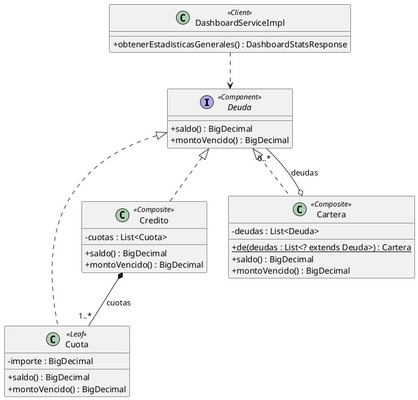

- **Qué cambia en el código.**
  - Nuevo `model/interfaces/Deuda.java` (2 métodos). `ICredito` e `ICuota` la extienden (los DTO siguen igual).
  - `model/Cuota.java`: `saldo()` y `montoVencido()` (dos métodos de 3 líneas; reutilizan `estaPagada`, `estaVencida`, `credito.isAnulado()`).
  - `model/Credito.java`: `saldo()` y `montoVencido()` pasan a sumar `Cuota::saldo` / `Cuota::montoVencido`; `sumarCuotas(Predicate)` se reemplaza por un `sumar(Function<Deuda, BigDecimal>)`; desaparece el `if (anulado) return ZERO` de `saldo()` porque ahora lo sabe la hoja.
  - Nuevo `model/Cartera.java` (no es entidad; ~25 líneas, inmutable, `Cartera.de(creditos)`).
  - `service/impl/DashboardServiceImpl.java`: los dos `reduce` pasan a `Cartera.de(creditos).saldo()` / `.montoVencido()`.
  - Tests: `CarteraTest` (cartera vacía, cartera con un anulado, cartera con vencidas) + ajustar `CreditoTest`/`CuotaTest`. Diagrama de clases (modelo).
- **Tamaño:** S-M. Sin cambio de API ni de frontend.
- **Riesgo de sobreingeniería: medio-bajo.** El árbol existe, la operación tiene sentido en los tres niveles y se borra código duplicado. El riesgo es que la profundidad es fija (no hay "cartera de carteras" usada hoy). Se compensa porque `Cartera` contiene `Credito`, que ya es compuesto: hay recursión, no una lista plana.
- **Variante con valor de negocio (opcional, S):** regla de otorgamiento "no se otorga un crédito a un cliente con cuotas vencidas" en `CreditoServiceImpl.crear`: `if (Cartera.de(creditoRepository.buscarPorCliente(dni)).montoVencido().signum() > 0) throw new BusinessException(...)`. Es política estándar de cualquier financiera (no prestarle a quien está en mora con vos), da un 400 que el front ya muestra, y le da al Composite un segundo cliente real (la cartera de **un** cliente). Ojo: cambia el comportamiento de UC07 y hay que agregarlo a la ficha y a `verificar-cu.sh`.
- **Defensa.**
  - Problema: la misma pregunta ("¿cuánto se debe?, ¿cuánto está vencido?") a una cuota, a un crédito o a toda la cartera, contestada con código distinto en cada nivel.
  - Solución: interfaz común `Deuda`; las hojas responden, los compuestos suman a sus hijos sin preguntar qué son.
  - GRASP/SOLID: Polymorphism, Information Expert (cada nivel sabe lo suyo), OCP (un nivel nuevo, p. ej. cartera por sucursal, no toca al cliente), LSP (cualquier `Deuda` sirve donde se pide una `Deuda`).
  - **Pregunta trampa probable: "¿Una lista de créditos sumada con un stream no es lo mismo? ¿Dónde está el árbol?"** Respuesta: el compuesto implementa la misma interfaz que sus hijos y puede contener otros compuestos. `Cartera` contiene `Credito`, que es a su vez compuesto de `Cuota`; el dashboard le pide `saldo()` a la cartera sin saber que hay dos niveles abajo. Una `List<Credito>` no es una `Deuda`.
  - **Segunda trampa: "¿Por qué `Credito` tiene `List<Cuota>` y no `List<Deuda>`?"** Porque es una asociación JPA: un crédito solo contiene cuotas. Es exactamente la consecuencia que nombra la cátedra ("dificulta restringir tipos"): elegimos restringir en `Credito` y dejar el compuesto genérico en `Cartera`. Y no hay `agregar/quitar` en la interfaz (variante "segura" de GoF): las cuotas las crea el crédito (Creator) y la cartera nace armada; así la hoja no hereda métodos vacíos (ISP).

#### Composite B — Reglas de otorgamiento combinables

- **Expansión que la justifica.** Política crediticia: antes de otorgar se chequean reglas (cliente sin mora, monto máximo, plazo máximo por plan). Las reglas se combinan con "todas deben cumplirse".
- **Participantes.** Component `ReglaDeOtorgamiento` (`verificar(cliente, request)`); Leaf `SinCuotasVencidas`, `MontoMaximo`, `PlazoMaximo`; Composite `TodasLasReglas`; Client `CreditoServiceImpl.crear`.

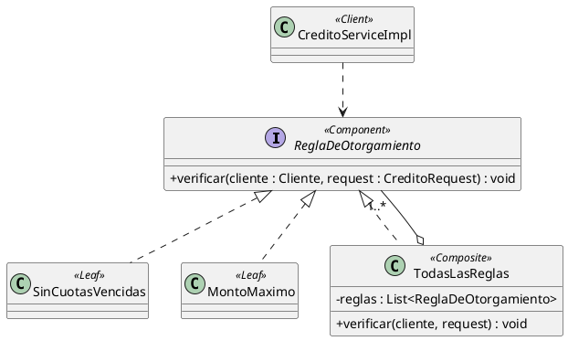

- **Cambios:** 4-5 clases nuevas, `CreditoServiceImpl`, configuración de qué reglas aplican. **Tamaño:** M.
- **Riesgo: alto.** Hoy existe una sola regla con sentido (la de mora). Inventar `MontoMaximo` y `PlazoMaximo` para que haya hojas es exactamente "patrón metido a la fuerza". Además, sin `CualquieraDeLasReglas` (OR) no hay árbol: es una lista. Es más bien el patrón Specification.
- **Trampa:** "¿Qué regla de negocio te pidió alguien?" No hay respuesta buena. **No conviene.**

#### Composite C — Refinanciación o consolidación de créditos

- **Expansión.** Un crédito nuevo que "agrupa" créditos anteriores del cliente. Existe en la realidad, pero **no es un Composite**: refinanciar cancela las deudas viejas y crea una nueva con otras condiciones; el saldo del refinanciado no es la suma de sus hijos vivos.

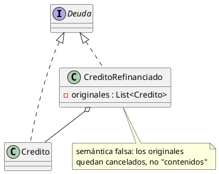

- **Tamaño:** L (estado nuevo, anulación en cascada, API, front). **Riesgo: alto** y además conceptualmente incorrecto. **No conviene.**

### 2.2 Decorator

> Cátedra: "agrega responsabilidades a un objeto dinámicamente, alternativa a la herencia; aplica cuando las responsabilidades se pueden otorgar o derogar, o cuando la herencia exigiría muchas subclases para las combinaciones".

#### Decorator A — Cargos sobre la cuota, decorando la Strategy (RECOMENDADA)

- **Expansión que la justifica.** Diagnóstico 4. Un préstamo personal real suma a la cuota cargos que **no son el sistema de amortización**: seguro de vida sobre saldo deudor y gastos de administración (y en Argentina, IVA sobre intereses). Cada cargo se otorga o se deroga por crédito (p. ej., el cliente endosa su propio seguro de vida y se le deroga el de la financiera). Con herencia serían `InteresSimpleConSeguro`, `SistemaFrancesConSeguroYGastos`, ...: 2 planes × 2^k combinaciones de cargos. Es literalmente el caso de la definición de cátedra.
- **Participantes.**
  - Component: `CalculoDeCuota` (la interfaz Strategy existente, sin cambios).
  - ConcreteComponent: `InteresSimple`, `SistemaFrances` (sin cambios).
  - Decorator: `model/plan/CargoSobreCuota` (abstracta; tiene un `CalculoDeCuota envuelto`, delega y le suma `cargo(...)`).
  - ConcreteDecorator: `SeguroDeVida` (porcentaje mensual sobre el capital) y `GastoDeAdministracion` (monto fijo por cuota).
  - Quién arma la pila: enum `TipoCargo` (mismo rol de registro que `TipoPlan`) con `aplicarSobre(CalculoDeCuota)`.
  - Client: `Credito.calculo()`: parte de `tipoPlan.calculo()` y lo envuelve con cada cargo del crédito.

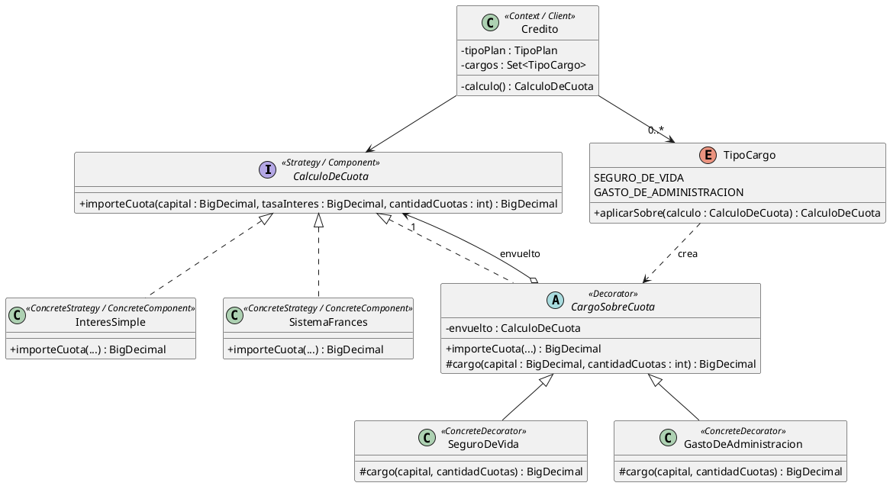

```java
// Decorator: agrega un cargo a la cuota que calcula la estrategia envuelta
public abstract class CargoSobreCuota implements CalculoDeCuota {
    private final CalculoDeCuota envuelto;
    protected CargoSobreCuota(CalculoDeCuota envuelto) { this.envuelto = envuelto; }

    @Override
    public BigDecimal importeCuota(BigDecimal capital, BigDecimal tasaInteres, int cantidadCuotas) {
        return envuelto.importeCuota(capital, tasaInteres, cantidadCuotas).add(cargo(capital, cantidadCuotas));
    }

    protected abstract BigDecimal cargo(BigDecimal capital, int cantidadCuotas);
}
```

```java
// en Credito
private CalculoDeCuota calculo() {
    CalculoDeCuota calculo = tipoPlan.calculo();
    for (TipoCargo cargo : cargos) {
        calculo = cargo.aplicarSobre(calculo);
    }
    return calculo;
}
```

- **Qué cambia en el código.**
  - Nuevos: `model/plan/CargoSobreCuota.java`, `model/plan/SeguroDeVida.java`, `model/plan/GastoDeAdministracion.java`, `model/TipoCargo.java`.
  - `model/Credito.java`: campo `@ElementCollection @Enumerated Set<TipoCargo> cargos` (tabla `credito_cargos`), `calculo()` arma la pila, `nuevo(...)` recibe los cargos (pasa a 7 parámetros: o se acepta y se defiende como BS5, o se agrega un overload `nuevo(...)` sin cargos para los llamadores actuales).
  - `dto/request/CreditoRequest.java`: `Set<TipoCargo> cargos` **opcional** (null o vacío = sin cargos). `dto/response/CreditoResponse.java`: `cargos`. `ICredito`: `getCargos()`.
  - Tests: `SeguroDeVidaTest`, `GastoDeAdministracionTest`, uno de pila doble sobre cada plan; `CreditoTest` con cargos (`totalADevolver` los incluye).
  - DER (tabla nueva), diagrama de clases, ficha UC07.
- **Frontend:** no es obligatorio. El campo es opcional; el front actual sigue otorgando sin cargos y la demo se hace por Swagger. Si se quiere mostrar en la UI, son dos checkboxes en `pages/Creditos.jsx` y una línea en la ficha (S). **Funcionalidad nueva visible: sí en la API (campo nuevo), opcional en la pantalla.**
- **Tamaño:** M.
- **Riesgo de sobreingeniería: medio.** El patrón encaja de manual y la combinación Strategy + Decorator es honesta (núcleo intercambiable + capas opcionales). El riesgo está en la expansión: hay que fijar valores creíbles (p. ej. seguro 0,1 % mensual sobre el capital, gasto $500 por cuota) y aceptar simplificaciones (el seguro real es sobre saldo, no sobre capital). Con dos decoradores concretos alcanza; un tercero solo si aporta algo distinto.
- **Por qué no IVA sobre intereses como decorador.** Necesita la porción de interés de cada cuota, que la Strategy actual no expone (solo devuelve el importe). Hacerlo bien exige Strategy B primero. Mencionarlo como límite, no implementarlo.
- **Defensa.**
  - Problema: cargos que se suman a la cuota, independientes del sistema de amortización, que se otorgan o derogan por crédito y se combinan libremente.
  - Solución: cada cargo envuelve al cálculo y le suma lo suyo; `Credito` no sabe cuántas capas hay.
  - GRASP/SOLID: OCP (cargo nuevo = clase nueva), SRP (cada decorador un cargo), LSP/Polymorphism (`Credito` usa un `CalculoDeCuota` sin saber si está decorado), Protected Variations.
  - **Pregunta trampa probable: "¿Esto no es otra Strategy?"** No: Strategy cambia **cómo** se calcula la amortización (uno u otro algoritmo, excluyentes); Decorator **agrega** algo alrededor sin tocar el núcleo, y se apilan (0, 1 o varios a la vez). Con Strategy necesitaríamos una estrategia por combinación plan × cargos.
  - **Segunda trampa: "¿El orden de los decoradores importa?"** Acá no: los dos cargos son aditivos y se calculan sobre el capital, así que conmutan. Si se agregara un cargo calculado sobre la cuota ya decorada (p. ej. un impuesto sobre todo), el orden sí importaría y habría que fijarlo en `TipoCargo`. Es la consecuencia que nombra la cátedra.
  - **Tercera: "¿Por qué el cargo no cambia después de otorgado?"** Por la misma razón que la Strategy no tiene `setEstrategia`: el importe de la cuota se fija al otorgar y se persiste. "Dinámico" es en tiempo de ejecución por objeto (cada crédito arma su pila), no a lo largo de la vida del crédito.

#### Decorator B — Auditoría de operaciones sobre los services (H8)

- **Hueco.** H8 (backlog 27/10): saber quién cobró y quién anuló.
- **Participantes.** Component `CobranzaService` / `CreditoService` (interfaces existentes); ConcreteComponent `CobranzaServiceImpl`; Decorator `CobranzaServiceAuditada` (delega y guarda un `RegistroDeOperacion` con usuario, operación, id, fecha); Client `CobranzaController`.

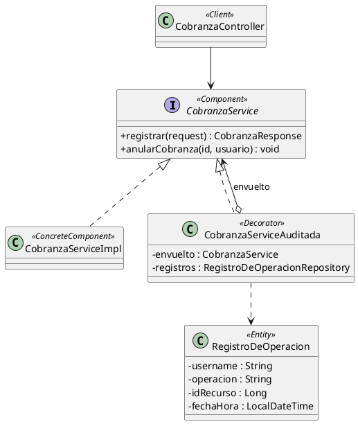

- **Cambios:** decorador por service, entidad y repositorio nuevos, `@Primary`/`@Qualifier` para que Spring inyecte el decorador, `registrar(request)` tiene que empezar a recibir el usuario (hoy no lo recibe). **Tamaño:** M.
- **Riesgo: medio-alto.**
  - H8 tal como está escrito pide **mostrar** quién cobró en `CobranzaResponse`: eso es un atributo de `Cobranza` (Expert), no una capa. El log de auditoría resuelve un problema vecino.
  - La auditoría de una financiera no se "otorga ni deroga": es obligatoria. Se pierde el argumento central de la cátedra.
  - El cableado en Spring (dos beans del mismo tipo, `@Transactional` en el decorador) oscurece el código.
  - **Trampa:** "¿Por qué no `@Aspect` de Spring?" o "¿por qué no un campo en Cobranza?". La segunda no tiene buena respuesta.
- **Veredicto:** hacer H8 con atributos (`registradaPor`, `anuladaPor` en `Cobranza`; `anuladoPor` en `Credito`), sin patrón, y no venderlo como Decorator.

#### Decorator C — Punitorios sobre la deuda vencida (Composite + Decorator)

- **Expansión.** Interés punitorio por atraso: real en todo préstamo (en Argentina, tope del 50 % del compensatorio). Se puede **condonar** por crédito (se deroga), lo que encaja con la cátedra.
- **Participantes.** Component `Deuda` (de Composite A); ConcreteComponent `Cuota`; Decorator `DeudaConPunitorio` (envuelve una `Deuda` y suma el punitorio a `montoVencido()` según días de atraso).

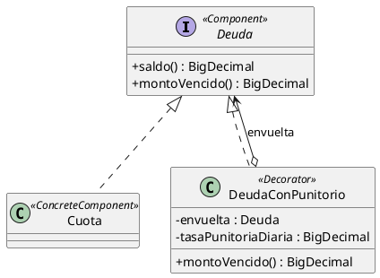

- **Por qué no.** Decorar una entidad JPA es incómodo (identidad distinta, la colección del crédito tiene `Cuota`, no `Deuda`); el cobro exige hoy el importe exacto de la cuota (TPO-006), así que habría que aceptar importe + punitorio, mostrarlo en la UI y recalcular el dashboard. Es casi O8. **Tamaño:** L. **Riesgo: alto.** Además el backlog ya descartó punitorios (O10) "porque no hay punitorios": meterlos para justificar un patrón contradice eso.

### 2.3 Facade

> Cátedra: "interfaz simple para usar un componente de algún tercero considerado complejo; que dos o más soluciones interactúen con acoplamiento mínimo". Se sugiere "cuando se requiere usar un componente externo complejo sin dejar fuertemente acoplada toda la solución".

#### Facade A — `AuthService` como fachada de Spring Security + JWT (RECOMENDADA)

- **Hueco.** No es funcionalidad nueva: el patrón **ya está** y no está nombrado. `AuthController` solo conoce `AuthService` (`registrar`, `login`, `actual`). `AuthServiceImpl` coordina un subsistema de terceros complejo: `AuthenticationManager` + `UsernamePasswordAuthenticationToken` (Spring Security), `PasswordEncoder` (BCrypt), `TokenService` (que a su vez es el Adapter sobre jjwt) y `UsuarioRepository`. Es la definición de cátedra casi palabra por palabra.
- **Participantes.** Facade: `AuthService` / `AuthServiceImpl`. Subsistema: `AuthenticationManager`, `PasswordEncoder`, `TokenService` → `JwtUtil` → jjwt, `UsuarioRepository`. Client: `AuthController`.

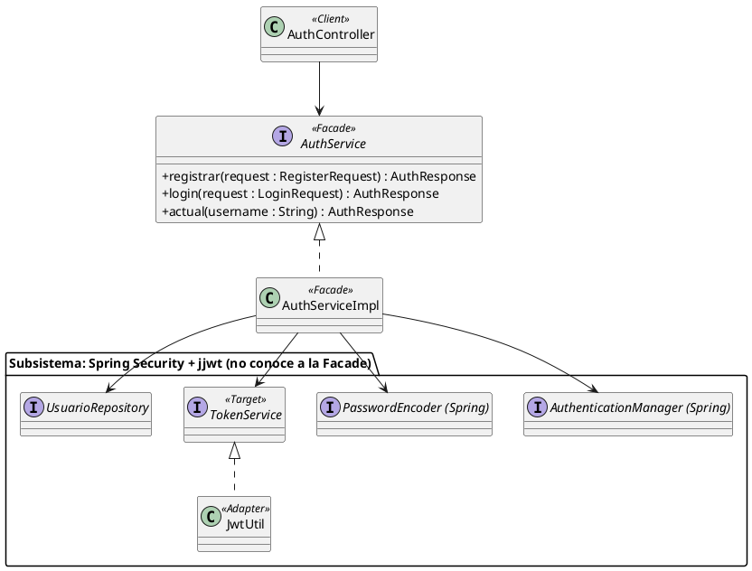

- **Qué cambia en el código.** Casi nada: comentario de una línea con el rol (convención COM: "Facade: interfaz simple sobre Spring Security y JWT"), estereotipos en `clases-v3.puml` → `clases-v4.puml` (vista de seguridad), entrada en la lista de mejoras y en el reporte con la plantilla problema / regla / consecuencia. Verificación concreta para escribir en el reporte: ningún controlador importa `AuthenticationManager`, `PasswordEncoder`, `Jwts` ni `TokenService` (se comprueba con `grep`). Única impureza: `AuthController.actual` recibe `@AuthenticationPrincipal UserDetails`; se puede dejar (es el borde HTTP) o cambiar a `UsuarioDetails` como hacen los otros controladores, por consistencia.
- **Tamaño:** S. Sin API ni front.
- **Riesgo de sobreingeniería: bajo** (no se agrega nada). El riesgo es de **percepción**: "no hiciste nada". Se responde mostrando que el patrón se reconoce y se nombra con los criterios de la cátedra, igual que se hizo con `UsuarioDetails` como Adapter en la iteración 3.
- **Defensa.**
  - Problema: autenticar con Spring Security exige armar tokens de autenticación, hashear, buscar el usuario y emitir el JWT en el orden correcto; si cada controlador lo hiciera, toda la capa web quedaría acoplada al framework y a jjwt.
  - Solución: una interfaz de tres operaciones de negocio; el subsistema no sabe que la fachada existe.
  - GRASP/SOLID: Low Coupling, Indirection, Protected Variations (si se cambia JWT por sesiones o se cambia el `AuthenticationManager`, cambia la fachada y no el controlador), DIP.
  - **Pregunta trampa probable: "Entonces todos tus services son Facade?"** No. `CreditoServiceImpl` o `CobranzaServiceImpl` coordinan **nuestro propio** dominio (eso es GRASP Controller: caso de uso que delega en el modelo). La diferencia de `AuthServiceImpl` es que lo que esconde es un componente **de terceros complejo**, que es lo que pide la definición. Nombrar Facade a todos los services diluye el patrón.
  - **Segunda trampa: "¿Facade o Adapter?"** Los dos están y se complementan: `JwtUtil` **adapta** una pieza (jjwt) a una interfaz que ya esperábamos (`TokenService`); `AuthService` **inventa** una interfaz nueva y más simple sobre varias piezas, una de las cuales es ese adapter. El apunte de la clase 10 lo anticipa: "si acumulás adapters sobre un mismo subsistema, la pregunta real es si falta una Facade".

#### Facade B — Cronograma de pagos en PDF sobre una librería externa

- **Expansión que la justifica.** Al otorgar un crédito, la financiera le entrega al cliente el cronograma de pagos (cuotas, vencimientos, importes, tasa). Es práctica estándar y la Ley de Defensa del Consumidor (art. 36) exige informar esos datos en operaciones de crédito. Generar un PDF con OpenPDF implica `Document`, `PdfWriter`, `PdfPTable`, `PdfPCell`, `Font`, `Paragraph`: un componente de terceros complejo, exactamente el caso de la cátedra.
- **Participantes.** Facade `GeneradorDeCronograma` (interfaz, `byte[] generar(ICredito credito)`) + `CronogramaPdf` (impl con OpenPDF). Subsistema: clases de OpenPDF. Client: `CreditoController` (endpoint nuevo).

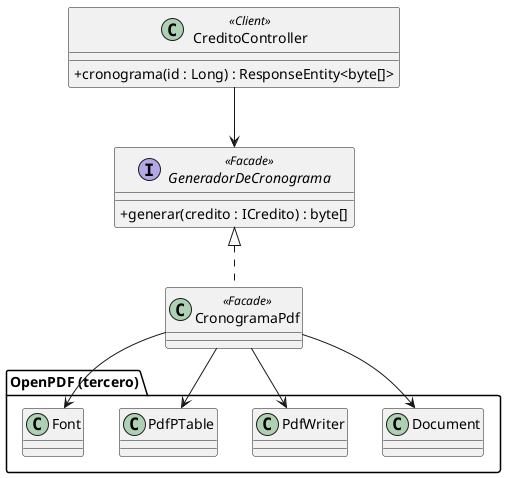

- **Cambios:** dependencia nueva en `backend/pom.xml`, 2 clases, `GET /api/creditos/{id}/cronograma` (`application/pdf`), método en `CreditoService`, test. Ojo con I3: hoy un `Accept` que no sea JSON da 406; el endpoint tiene que declarar `produces = application/pdf`. **Tamaño:** M.
- **Funcionalidad nueva visible: sí (endpoint).** El front no es imprescindible (se prueba por Swagger), pero el valor real aparece con un botón "Descargar cronograma" en la ficha del crédito (S en `pages/Creditos.jsx` y `api/creditos.js`).
- **Riesgo: medio.** El patrón es de manual y la funcionalidad es real; el riesgo es meter una dependencia y una feature con la principal motivación de mostrar el patrón. Es el **plan B** si el profe pide "código nuevo" para Facade.
- **Trampa:** "¿No es un Adapter sobre OpenPDF?" No: no hay una interfaz previa que el cliente espere; se inventa una operación de negocio (`generar cronograma`) que orquesta muchas clases de la librería.

#### Facade C — `DashboardService` como fachada de repositorios y modelo

- `DashboardServiceImpl` combina tres repositorios y el modelo en una sola llamada. Técnicamente "interfaz simple sobre varios objetos", pero el subsistema es **propio y simple**, no de terceros. Llamarlo Facade es estirar la definición de cátedra y abre la trampa de "entonces todos tus services son Facade".

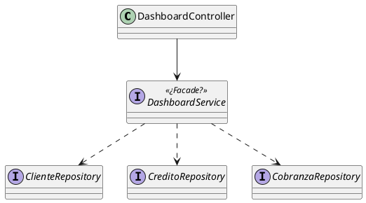

- **Tamaño:** S. **Riesgo: medio** (no por código, por defensa débil). **No conviene.**

### 2.4 Strategy: ¿está bien aplicada? ¿se puede usar mejor?

**Veredicto: está bien aplicada.** Contexto, interfaz y concretas correctas; elección fuera del contexto (`TipoPlan`); sin `switch`; sin `setEstrategia` por una razón de dominio. La pregunta trampa conocida ("¿dónde está el atributo estrategia del Contexto?") ya tiene respuesta: JPA no persiste una interfaz, se persiste `tipoPlan`, que es la referencia a la estrategia.

#### Strategy A — Dejarla como está (RECOMENDADA para esta iteración)

Con Decorator A se enriquece sin tocarla: pasa a ser también el Component del Decorator. **Tamaño:** 0.

#### Strategy B — La estrategia arma el plan completo (capital, interés, último ajuste)

- **Hueco:** O3b (el centavo) y la mitad de P-M9 (capital/interés separados). En el sistema francés real la cuota es fija pero el interés baja y la amortización sube cuota a cuota; hoy eso no se ve.
- **Cambio:** `CalculoDeCuota.planDeCuotas(capital, tasa, n) : List<ImporteDeCuota>` con `ImporteDeCuota(capital, interes)` (record); `Credito.generarPlanDeCuotas` usa esa lista; `Cuota` guarda `capital` e `interes`; la última cuota absorbe el redondeo.

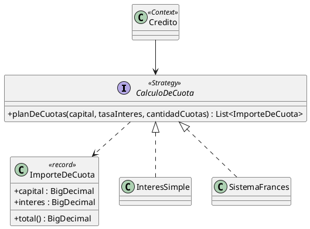

- **Tamaño:** M-L (cambia `Cuota`, `importeCuota` deja de ser único, DTO, DER, tests de estrategias, ficha). **Riesgo: medio.** Mejora real del dominio y habilita un decorador de IVA sobre intereses, pero no es necesaria para ningún patrón de esta iteración. Dejar en backlog.

#### Strategy C — Tasa expresada siempre como TNA (P-M9, primera mitad)

- **Hueco:** la misma entrada `tasaInteres` significa cosas distintas según la estrategia. En Argentina los préstamos se informan por TNA (y TEA/CFT); cada estrategia convertiría la TNA a lo que necesita (simple: TNA × n/12; francés: TNA/12).

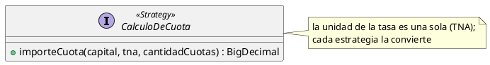

- **Tamaño:** S-M (dos fórmulas, tests, `CreditoRequest`, texto de `descripcionPlan` y el placeholder del front). **Riesgo: bajo** en diseño, pero **toca el front** (rótulo) y cambia los números de todos los ejemplos documentados. Buena mejora de Protected Variations; no es de esta iteración.

### 2.5 Adapter: ¿está bien aplicado?

**Veredicto: bien aplicado, no agregar más.**

- `JwtUtil` (Object Adapter sobre jjwt, traduce excepciones, Target sin tipos externos) y `UsuarioDetails` (adapta `IUsuario` a `UserDetails`) cumplen las reglas del apunte. Lo único discutible es el nombre `JwtUtil` (un "Util" que es un Adapter), pero el grupo ya lo fijó como excepción documentada; renombrar ahora es ruido.
- Con Facade A el Adapter gana contexto: queda dentro del subsistema que la fachada esconde, que es la relación que el apunte describe.
- Candidatos que **no** son Adapter honesto: `PasswordEncoder` (ya es la abstracción de Spring, O10), OpenPDF (si se hace Facade B, es Facade, no Adapter), `fetch` del front (O10).

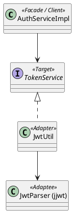

### 2.6 Combinaciones honestas

| Combinación | ¿Honesta? | Por qué |
|---|---|---|
| Decorator sobre Strategy (`CargoSobreCuota` envuelve `CalculoDeCuota`) | **Sí** | Núcleo excluyente (plan) + capas apilables (cargos): cada patrón hace lo suyo y la pregunta "¿Strategy o Decorator?" se contesta mostrando los dos juntos |
| Facade que usa un Adapter (`AuthServiceImpl` → `TokenService`/`JwtUtil`) | **Sí** | Ya existe; es la relación que describe el apunte de clase 10 |
| Composite + Decorator (punitorios sobre `Deuda`) | No por ahora | Correcta en teoría, pero arrastra mora con cobro de punitorios (L) |
| Composite + Strategy (la cartera elige cómo agregar) | No | No hay dos formas de sumar una cartera |

---

## 3. Recomendación final

### Set mínimo coherente (ordenado por valor / esfuerzo)

| Orden | Patrón | Opción | Tamaño | API / front | Qué deja |
|---|---|---|---|---|---|
| 1 | Facade | **A**: `AuthService` sobre Spring Security + JWT | S | No / No | Patrón reconocido y nombrado con la definición de cátedra; historia coherente con el Adapter |
| 2 | Composite | **A**: `Deuda` ← `Cuota`, `Credito`, `Cartera` | S-M | No / No | Saldo y mora a cualquier nivel; borra las sumas del dashboard y de `Credito` |
| 2b | (opcional) | Regla "no se otorga a clientes en mora" con `Cartera` del cliente | S | 400 nuevo / No | Segundo cliente real del Composite y una regla de negocio genuina |
| 3 | Decorator | **A**: cargos (`SeguroDeVida`, `GastoDeAdministracion`) envolviendo `CalculoDeCuota` | M | Campo opcional `cargos` / opcional | La combinación Strategy + Decorator, con el argumento literal de la cátedra (otorgar/derogar, explosión de subclases) |
| — | Strategy | A: sin cambios | 0 | — | Pasa a ser Component del Decorator |
| — | Adapter | Sin cambios | 0 | — | Queda dentro del subsistema de la Facade |

Resultado: el modelo gana una jerarquía explícita (Composite) y una capa de cargos (Decorator) sin tocar el frontend; la Facade se documenta. En total: ~7 clases nuevas chicas, 1 tabla nueva (`credito_cargos`), 0 endpoints nuevos.

Orden sugerido de commits: (1) `Deuda` + `Cuota`/`Credito` + tests; (2) `Cartera` + dashboard; (3) regla de mora (si se hace); (4) decoradores + `TipoCargo` + tests; (5) `cargos` en `Credito`, request, response, DER; (6) comentario de rol en `AuthServiceImpl` + diagramas + lista de mejoras + reporte. H8 va aparte, sin patrón.

### Lo que explícitamente NO conviene hacer

| Qué | Por qué no |
|---|---|
| H8 como Decorator de auditoría | H8 pide un dato de la cobranza (Expert); la auditoría no se "deroga"; obliga a cablear dos beans del mismo tipo en Spring |
| Composite de reglas de otorgamiento | Una sola regla real; habría que inventar hojas para justificar el árbol |
| Composite de refinanciación | Semántica falsa: refinanciar cancela, no contiene; además L |
| Composite de permisos / roles | Dos booleans (`Permisos`); un árbol RBAC es sobreingeniería pura |
| Decorator de punitorios | Requiere cobrar importe + punitorio (choca con TPO-006, casi O8) y contradice el descarte O10 |
| Decorator sobre entidades JPA en general | Identidad distinta del decorado (la cátedra lo marca) + proxies de Hibernate: confuso |
| Llamar Facade a todos los services | Diluye el patrón; la cátedra lo define sobre componentes de terceros |
| Facade sobre `DashboardService` | Subsistema propio y simple: un salto más sin beneficio |
| IVA sobre intereses como decorador ahora | Necesita el desglose de interés que solo da Strategy B |
| State para `EstadoCredito` | Ya descartado (O9): estado derivado, una sola transición |
| Más Adapters (PasswordEncoder, fetch) | Ya descartados (O10) |
| Renombrar `JwtUtil` | Excepción ya documentada; cambio cosmético en medio de la iteración |

## 4. Impacto visible (endpoint o pantalla)

| Opción | Endpoint nuevo | Cambio de contrato | Pantalla |
|---|---|---|---|
| Composite A | No | No | No |
| Regla de mora (2b) | No | UC07 puede dar un 400 nuevo | No (el front ya muestra el error del alta) |
| Decorator A | No | `cargos` opcional en `CreditoRequest` y en `CreditoResponse` | Opcional: dos checkboxes y una línea en la ficha |
| Facade A | No | No (opcional: `actual` recibe `UsuarioDetails`) | No |
| Facade B (plan B) | **Sí**, `GET /api/creditos/{id}/cronograma` | Sí | Opcional: botón "Descargar cronograma" |
| Strategy C | No | Cambia el significado de `tasaInteres` | **Sí**: rótulo y placeholder de la tasa |
| Decorator B (no recomendado) | Probablemente (consultar auditoría) | `registrar` recibe usuario | Si se quiere ver |
| Decorator C (no recomendado) | No | Importe a cobrar cambia | **Sí** |

---

### Anexo: definiciones de cátedra (slides clase 12, texto literal)

- **Composite**: "Compone objetos en estructura de árbol. Permite que un cliente trate de forma polimórfica a un objeto particular y a un conjunto combinado de ellos." Consecuencias: "Simplifica el uso de estructuras recursivas. Dificulta restringir tipos específicos en algunos contextos."
- **Decorator**: "Agrega responsabilidades a un objeto dinámicamente. Es una alternativa flexible a la herencia [...] Cuando las responsabilidades se pueden otorgar o derogar, se puede aplicar. Cuando la herencia sea muy compleja porque implique la creación de múltiples subclases para dar soporte a todas las combinaciones posibles, es aplicable." Consecuencias: "Un decorador y el componente al que se refieren no son idénticos [...] Provoca la creación de muchos objetos pequeños parecidos y encadenados, dificultando la depuración."
- **Facade**: "Expone una interfaz simple para la utilización de un componente de algún tercero, generalmente, considerado 'complejo'. Permite que dos o más soluciones/proyectos interactúen, manteniendo el acoplamiento al mínimo posible." Consecuencias: "Puede ocultar funcionalidades avanzadas si se abusa."
